 # Direct photon anisotropic flow as a probe of $\alpha$-clustered structure in 7A TeV $^{16}$O + $^{16}$O collisions at the LHC

**ATHIC 2026 · Fudan University . Shanghai, China**  
Pingal Dasgupta

*Collaborators: Sanchari Thakur, Rupa Chatterjee, Shinjini Chandra and Siddharth K. Prasad*

---

# Outline
1. **QGP and Electromagnetic Probes** 

2. **What Makes O+O collisions interesting**

3. **Results**

4. **Summary**

---

# Quark Gluon Plasma

<figure>
  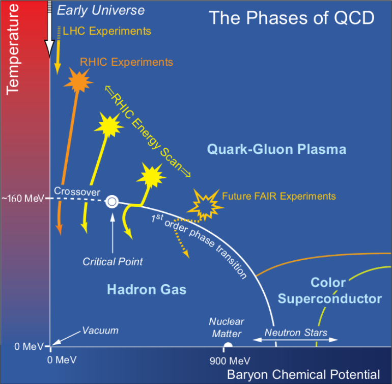
  <figcaption>QCD phase diagram. Source: <a href="https://www.bnl.gov/newsroom/news.php?a=21870">Brookhaven National Laboratory</a>.</figcaption>
</figure>

<!-- - ##### QGP (Quark Gluon Plasma) is a deconfined state of quarks and gluons that existed a few micro-seconds after the bigbang. -->

<!-- ##### Relativistic Heavy Ion Collision produces a deconfined pahse of Quarks and Gluons that mimics early universe !! -->

<!-- - ##### Prodcued hadrons and their phase space distributions are indirect probe to understand thermodynamic and dynamic properties of QGP. -->

- Relativistic Heavy Ion Collisions produce deconfined phase of Quarks and Gluons that mimics early universe !!

- We can know about the thermodynamic and dynamic properties of QGP.

---

# Electromagnetic Probes 

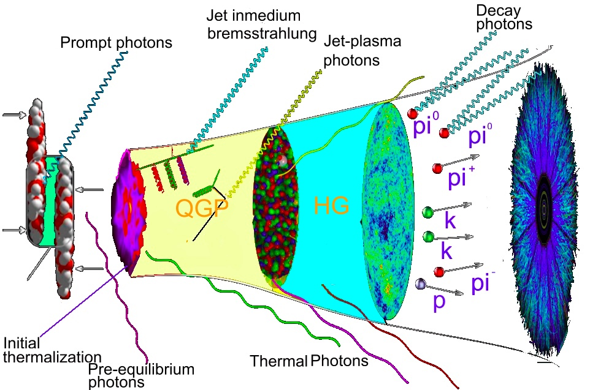
<figcaption>Spacetime evolution of fireball. Source: <a href="https://u.osu.edu/vishnu/physics/">OSU_edu</a>.</figcaption>
</figure>

- Electromagnetic probes are clean donot suffer finalstate interactions.

- Sensitive to initial state of collisions and formation time.

- Two types of direct signals : direct photons and dileptons.

---

# Anisotropic Flow 

- The inital spatial anispotropy ($\epsilon_2$, $\epsilon_3$,..) in the overlap zone converts into momentum anisotropy $\rightarrow$ evidence of the strongly interacting hot dense medium.

The particle momentum distribution can be expanded in Fourier´s Series as follows:

$\begin{equation}\label{eq: v2}
 \frac{dN}{d^2p_Tdy} = \frac{1}{2\pi} \frac{dN}{ p_T dp_T dy}[1+ 2 \sum_{n=1}^{\infty} v_n (p_T)  \rm{cos} n (\phi - \psi_n)].
\end{equation}$

 See below how velocity emerges due to initial pressure gradients.

<video controls width="400">
  <source src="animation_TwithFlow_woif.mp4" type="video/mp4">
</video>

---

# $\alpha$-clustering

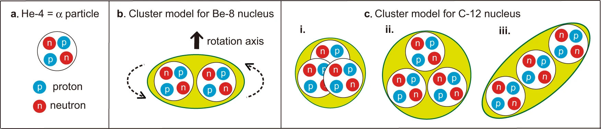
<figcaption>$\alpha$ clustering. Source: <a href="https://www.nature.com/articles/s41467-022-29582-0">Nature</a>.</figcaption>
</figure>

- Clustering refers to a phenomenon where nuclei (with A = 4N such as $^8$Be, $^{12}$C, $^{16}$O etc.) behave like a molecule composed of $\alpha$-clusters.

-  Experiment  still lacks direct evidence in support of $\alpha$-clustering in nuclear ground states of light nuclei. Some first principle theory such as QMD has prediction in support [Nature]. 

---

# Probing α-clustered Structure in Collider Experiments

- Pioneering work:  “Signatures of alpha clustering in light nuclei from relativistic nuclear collisions”- Wojciech Broniowski and Enrique Ruiz Arriola, Phys.Rev.Lett. 112, 112501(2014).

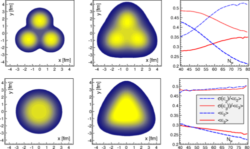
<figcaption>C+Pb @ 17A GeV using GLISSANDO. Source: <a href="https://journals.aps.org/prl/abstract/10.1103/PhysRevLett.112.112501">Broniowski, Arriola PRL 2014</a>.</figcaption>
</figure>
[Followed by many studies employing realistic dynamic models or machine learning to capture signature of clustering from observables.]

.....

---

# Effects on  Direct Photons

First study of clustering effects on direct photon observables :

1.  "Thermal photons as a sensitive probe of $\alpha$-cluster in C+ Au collisions at the BNL Relativistic Heavy Ion Collider", PD, G.L. Ma, R. Chatterjee, et al.,Eur. Phys. J. A 57 (4) 134 (2021).

2. "Production and anisotropic flow of thermal photons in collisions of $\alpha$-clustered carbon with heavy nuclei at relativistic energies", PD, R Chatterjee, G.L. Ma Phys. Rev. C 107, 044908 (2023).

<!-- 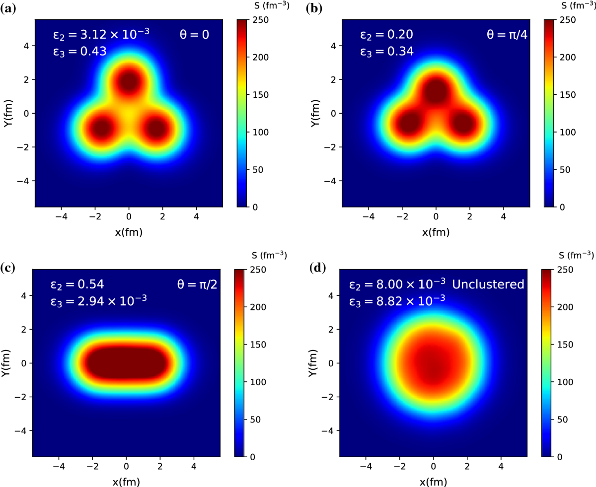

<figcaption>C+Au @ 200AGeV Initial state Energy profiles with and without alphaing cluster. Source: <a href="https://link.springer.com/article/10.1140/epja/s10050-021-00441-8">PD, G.L. Ma ${\it et.al}$.</a>.</figcaption>
</figure> -->

  <figure style="margin: 0; text-align: center;">
    
    <figcaption>(a) C+Au @ 200AGeV Initial state energy density profiles with and without alphaing cluster. <a href="https://link.springer.com/article/10.1140/epja/s10050-021-00441-8">PD, G.L. Ma ${\it et.al}$.</a></figcaption>
  </figure>

  <figure style="margin: 0; text-align: center;">
    
    <figcaption>(b) Triangular Flow as a function of $p_T$ for most central C*Au collisions <a href="https://journals.aps.org/prc/abstract/10.1103/PhysRevC.107.044908">PD, RC, G.L. Ma ${\it et.al}$.</a></figcaption>
  </figure>

---

## Why O+O Collisions?

- Small systems have  shown promising collective behaviour in flow observables. 

- Oxygen has a ${\color{red} \rm tetrahedral}$ structure. Relativistic collision at very high energies can capture certain structural deformation.

  <figure style="margin: 0; text-align: center;">
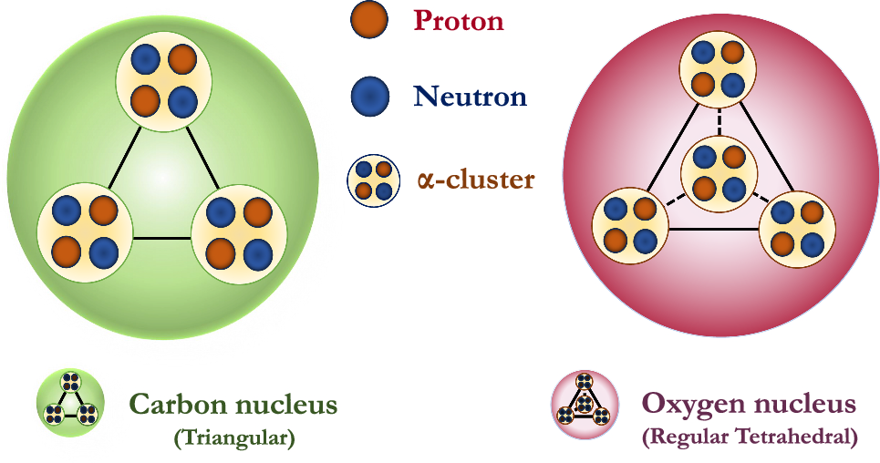
<figcaption>Oxygen Source:<a href="https://link.springer.com/article/10.1140/epja/s10050-025-01608-3?fromPaywallRec=false"> Tetrahedral </a>.</figcaption>
</figure>

  <figure style="margin: 0; text-align: center;">
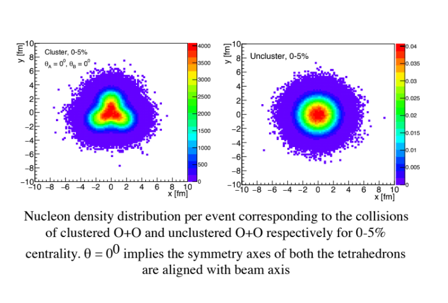
<figcaption>Overlap nucleon density distriution Source: <a href="https://ujk.edu.pl/homepages/mryb/GLISSANDO/">GLISSANDO</a>.</figcaption>
</figure>

---

## O+O @7A TeV Collisions at LHC

- ${\rm \color{red}GLISSANDO3}$ : GLauber Initial State Simulation AND mOre an established Monte Carlo event generator to characterize the initial stages of relativistic heavy-ion collisions.

- Two cases are considered: clustered and unclustered.  

- Glissando3 shows that the most central collisions are important as they are expected to show the geometry dominated effect (cluster structure)
more clearly compared to the peripheral collisions.

  <figure style="margin: 0; text-align: center;">
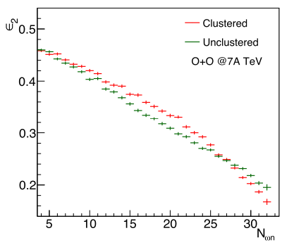
<figcaption>Initial Eccentricity Source: $\epsilon_2$</figcaption>
</figure>

  <figure style="margin: 0; text-align: center;">
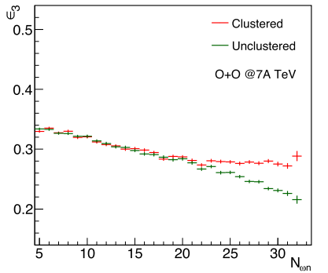
<figcaption>Initial Triangularity Source:<a href="https://link.springer.com/article/10.1140/epjc/s10052-026-16194-x"> $\epsilon_3$</a>.</figcaption>
</figure>

---

## Framework : O+O @7A TeV

- GLISSANDO3 initial condition.

- Ideal hydrodynamical framework $\color{red} \rm MUSIC$ is used for the
evolution of the initial conditions

- Initial formation time of the system formed at 0.14 fm/c

- Equation of State: $\color{red}\rm lattice EOS s95p-v1$

- A crossover transition from hot and dense plasma to hadronic gas is considered to happen at a temperature of
about 184 MeV.

- The freeze-out temperature is taken at 137 MeV.

- QGP rates → P. Arnold et. al. JHEP 0112, 009 (2001).
(leading order contributions)
→ J.Ghiglieri eta. al. JHEP 1305, 010 (2013).
(next-to-leading order contributions).

- Hadronic rates → S. Turbide et. al. Phys. Rev. C 69 014903 (2004).

<!-- 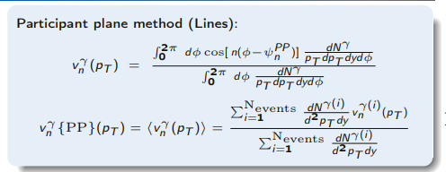
<figcaption>Partcipant Plane Method. </figcaption>
</figure> -->

Anisotropic flow cofficients are defined as : 
$\begin{eqnarray}
v_n (p_T) \ = \ \frac{\int_0^{2\pi} :
	d\phi {\rm cos} [n (\phi-\psi_{n})] \frac{dN}{p_T dp_T dy d\phi}}{\int_0^{2\pi}\,d\phi \frac{dN}{p_Tdp_Tdy d\phi}}
\end{eqnarray}$

---

## Direct Photon Spectra

  <figure style="margin: 0; text-align: center;">
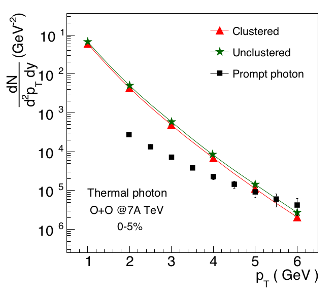
<figcaption>Direct photon spectra 0-5% Source: <a href="https://link.springer.com/article/10.1140/epjc/s10052-026-16194-x">ST, PD, RC, ${\it et. al.}$, EPJC</a>.</figcaption>
</figure>
</figure>

  <figure style="margin: 0; text-align: center;">
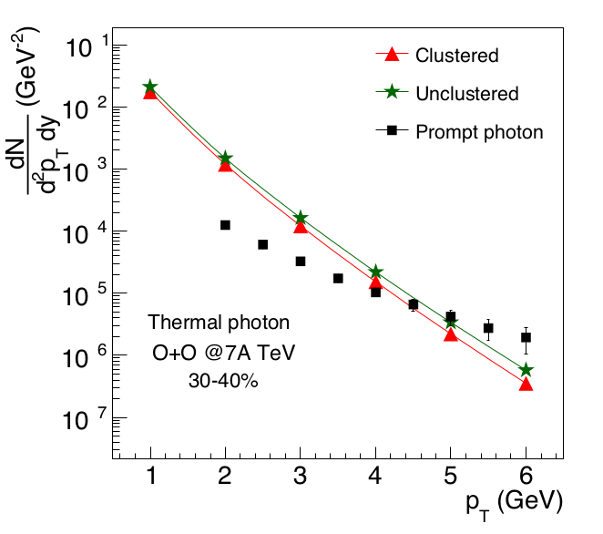
<figcaption>Direct photon spectra 30-40%  Source: <a href="https://link.springer.com/article/10.1140/epjc/s10052-026-16194-x">ST, PD, RC, ${\it et. al.}$, EPJC </a>.</figcaption>
</figure>

Two casses have been studied (a) Central (0-5%) (b) Peripeheral (30-40%).

- The direct photon spectra are comparable between clustered and unclustered collisions.

---

## Direct Photon Flow Observables

  <figure style="margin: 0; text-align: center;">
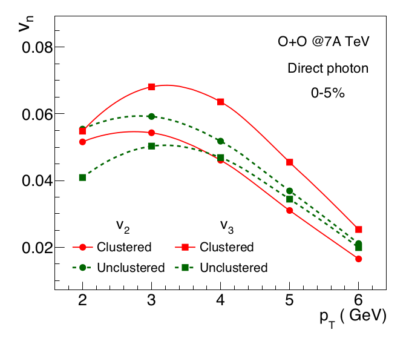
<figcaption>Direct photon anisotropic flow for 0-5% Source: <a href="https://link.springer.com/article/10.1140/epjc/s10052-026-16194-x">ST, PD, RC, ${\it et. al.}$, EPJC</a>.</figcaption>
</figure>
</figure>

  <figure style="margin: 0; text-align: center;">
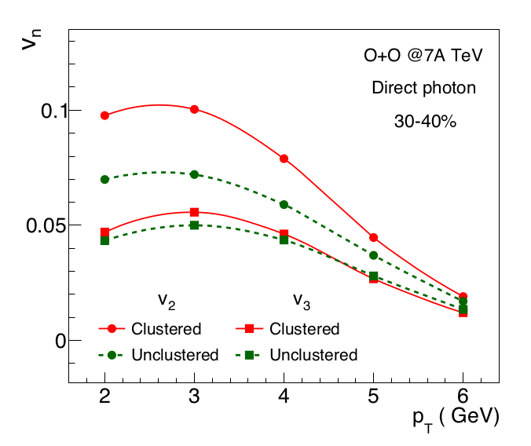
<figcaption> Direct photon anisotropic flow for 30-40%Source: <a href="https://link.springer.com/article/10.1140/epjc/s10052-026-16194-x">ST, PD, RC, ${\it et. al.}$, EPJC </a>.</figcaption>
</figure>

- The direct photon $v_3$ is substantially larger in comparison to the unclustered case, for 0-5% O+O@7A TeV collsions. The $v_2$ from the clustered collisions is slightly smaller in comparison to the unclustered case at the same centrality.

- The direct photon $v_2$ is substantially larger in comparison to the unclustered case, for 30-40% O+O@7A TeV collsions. The $v_3$ from the clustered collisions is comparable to the unclustered case at the same centrality.

---

## Ratio of Flow Observables

  <figure style="margin: 0; text-align: center;">
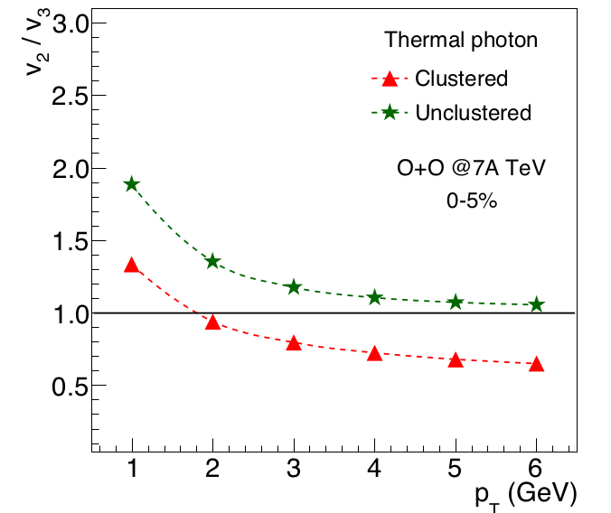
<figcaption> Ratio of $v_2$ and $v_3$ for 0-5%  Source: <a href="https://link.springer.com/article/10.1140/epjc/s10052-026-16194-x">ST, PD, RC, ${\it et. al.}$, EPJC</a>.</figcaption>
</figure>
</figure>

  <figure style="margin: 0; text-align: center;">
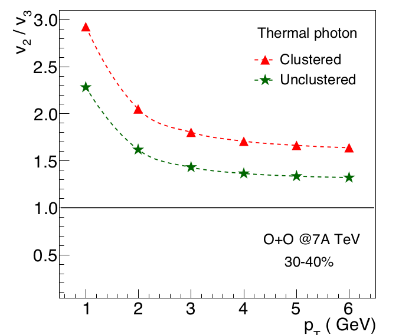
<figcaption> Ratio of $v_2$ and $v_3$ for 30-40% Source: <a href="https://link.springer.com/article/10.1140/epjc/s10052-026-16194-x">ST, PD, RC, ${\it et. al.}$, EPJC </a>.</figcaption>
</figure>

- Ratio is an effcient observable is it is not diluted by the Prompt contributions [<a href="https://journals.aps.org/prc/abstract/10.1103/PhysRevC.104.064907">RC, PD PRC </a>].

- The Ratio of $v_2$ and $v_3$ shows just opposite behaviour beween central and peripheral collisions.

---

## Summary

- The alpha-cluster structure in light nuclei produces significant initial spatial anisotropy which is expected to impact the momentum anisotropies (flow) of final state particles significantly.

- Measurement of the anisotropic flow parameters of the photons can serve as an important observable to study the cluster structure.

- We have studied the anisotropic flow parameters of photons for both clustered and unclustered O+O collisions at 7A TeV using hydrodynamical model MUSIC whereas the initial profiles used in our calculation have been taken from GLISSANDO model.

- Elliptic flow ($v_2$) is larger for most central unclustered O+O collisions $\rightarrow$ consistent with the average initial elliptic eccentricities and triangular flow ($v_3$) is larger for most central clustered O+O collisions $\rightarrow$ consistent with the average initial triangular anisotropy.

- Comparison of these simulation results with the proposed O+O collisions data at LHC at 7 TeV can be a good experimental evidence to verify the existence of cluster structure in Oxygen nuclei.

---

## 

#### Thank you for your attention!

